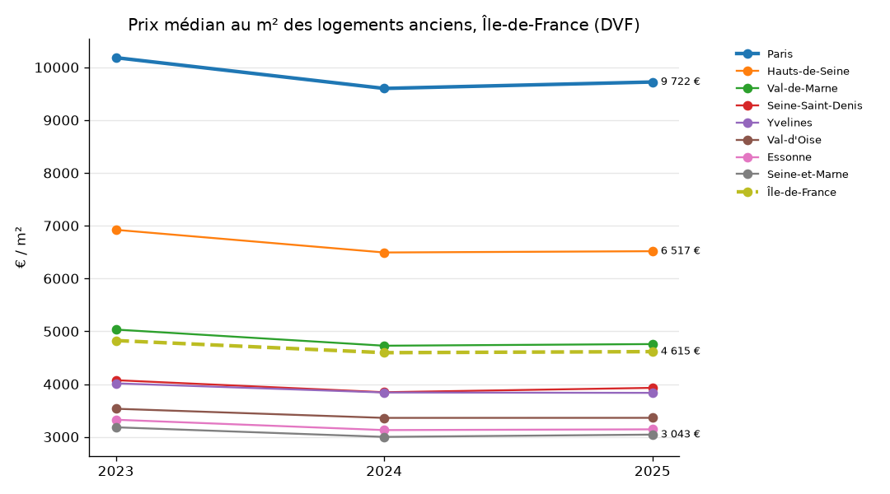
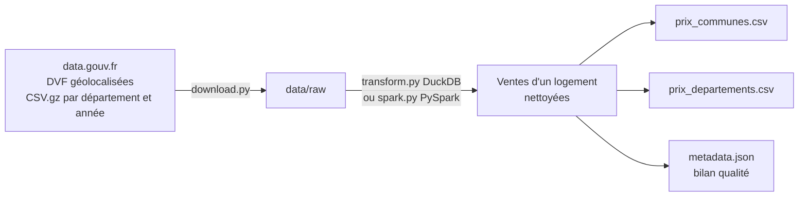

# Prix de l'immobilier en Île-de-France


Pipeline de données qui transforme les ventes immobilières publiques (DVF) en prix médians au m² par commune, par année et par type de bien.
Il existe en deux versions qui appliquent les mêmes règles : **DuckDB** pour tourner en quelques secondes sur un portable, **PySpark** pour passer à l'échelle (toute la France, un cluster Databricks). Un test vérifie que les deux donnent les mêmes chiffres.



## Résultats (2023 à 2025)

Prix médian au m², tous logements confondus :

| Département | 2023 | 2024 | 2025 | Ventes 2025 |
|---|---:|---:|---:|---:|
| Paris (75) | 10 183 € | 9 600 € | 9 722 € | 28 777 |
| Hauts-de-Seine (92) | 6 922 € | 6 493 € | 6 517 € | 18 060 |
| Val-de-Marne (94) | 5 033 € | 4 727 € | 4 758 € | 13 220 |
| Seine-Saint-Denis (93) | 4 074 € | 3 846 € | 3 929 € | 11 942 |
| Yvelines (78) | 4 014 € | 3 841 € | 3 834 € | 14 961 |
| Val-d'Oise (95) | 3 533 € | 3 360 € | 3 361 € | 11 313 |
| Essonne (91) | 3 325 € | 3 129 € | 3 143 € | 13 100 |
| Seine-et-Marne (77) | 3 182 € | 3 000 € | 3 043 € | 15 499 |
| **Île-de-France** | **4 825 €** | **4 595 €** | **4 615 €** | **126 872** |

Sur 1,3 million de lignes brutes (524 000 mutations), 356 000 ventes d'un logement sont retenues. Le détail par commune (1 138 communes publiées) est dans [`data/prix_communes.csv`](data/prix_communes.csv), le bilan qualité dans [`data/metadata.json`](data/metadata.json).

## Ce que fait le pipeline



1. **Téléchargement** : les dernières années publiées sont détectées sur l'index de la source ; un fichier déjà à jour n'est pas retéléchargé.
2. **Lecture** : tout est lu en texte puis converti explicitement, pour ne dépendre d'aucune détection automatique de type.
3. **Nettoyage** (voir ci-dessous), puis **agrégation** avec `GROUPING SETS` : par commune, année et type de bien, plus les totaux « Tous » et « Ensemble ».

## Méthode

DVF contient une ligne par local **et** par nature de culture de la parcelle : une maison avec jardin apparaît plusieurs fois, un appartement vendu avec sa cave aussi. Le prix au m² n'a de sens que si la vente porte sur un seul logement. Une mutation est donc retenue si :

- elle ne contient que des lignes « Vente » (pas de vente sur plan, d'échange ni d'adjudication) ;
- elle a une seule disposition et aucun local professionnel ;
- elle porte sur **un seul** appartement ou une seule maison (les dépendances sont ignorées) ;
- la surface est entre 9 et 400 m² et le prix entre 500 et 30 000 €/m², pour écarter les erreurs de saisie et les ventes symboliques ;
- une médiane n'est publiée que si elle repose sur au moins 5 ventes.

Chaque règle est couverte par un test sur un petit fichier DVF fabriqué à la main (`tests/test_pipeline.py`).

## Utilisation

```bash
python -m venv .venv
.venv/Scripts/activate        # Windows ; sous Linux : source .venv/bin/activate
pip install -r requirements.txt
python -m pipeline.run                    # télécharge 5 ans et calcule avec DuckDB
python -m pipeline.run --annees 3         # seulement les 3 dernières années
```

Version PySpark (Java 17 requis) :

```bash
pip install -r requirements-dev.txt
python -m pipeline.run --moteur spark --sans-telechargement
```

## Tests

```bash
pip install -r requirements-dev.txt
python -m pytest
```

- `tests/test_pipeline.py` : règles de nettoyage (doublons de culture, dépendances, ventes groupées, VEFA, valeurs aberrantes, seuil de publication).
- `tests/test_spark.py` : la version PySpark produit les mêmes fichiers et le même bilan que la version DuckDB.
- Sur les données réelles (1,3 million de lignes, 2023 à 2025), les deux moteurs donnent les mêmes nombres de ventes, médianes et quartiles pour les 7 551 lignes communales. Seules les coordonnées du centre de commune peuvent différer d'une unité au cinquième chiffre après la virgule (environ un mètre), à cause de l'arrondi des flottants.
- La CI GitHub Actions lance l'ensemble avec Java 17 et Spark 3.5.

## Source

[Demandes de valeurs foncières géolocalisées](https://www.data.gouv.fr/fr/datasets/demandes-de-valeurs-foncieres-geolocalisees/), Etalab, licence Ouverte 2.0.

## Auteur

**Sami Guetarni** · Ingénieur logiciel et data · [LinkedIn](https://www.linkedin.com/in/sami-guetarni-7b671820b) · [GitHub](https://github.com/Ednar17)
